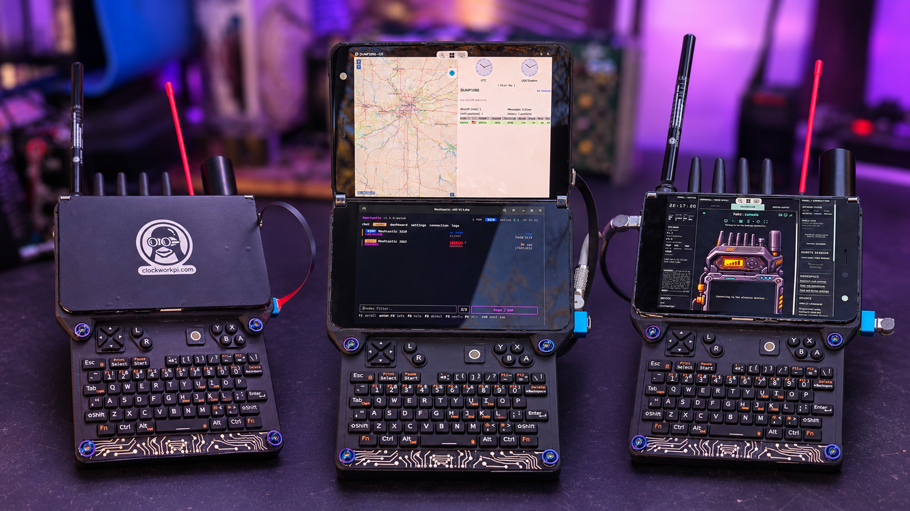

# haKCdevConsole

A Surface Duo used as a wired, touch-controlled desktop display for a ClockworkPi uConsole. The uConsole runs Ubuntu; the Duo runs an Android RDP client. The keyboard and trackball remain physically attached to the uConsole.

The cable carries a local IP connection created by Android USB tethering. GNOME Remote Desktop creates a virtual monitor in the existing Wayland login session. The Android client displays that monitor and sends touch input back over USB. There is no cloud relay, home server, browser viewer or internet dependency in this desktop data path.

This is a documented working prototype, not a universal device image or a one-click installer.

## Start here

- [Setup instructions](docs/SETUP.md)
- [How the monitor and input work](docs/ARCHITECTURE.md)
- [Verified results and limitations](docs/VALIDATION.md)
- [Troubleshooting and rollback](docs/TROUBLESHOOTING.md)
- [Technical Reddit write-up](docs/REDDIT.md)
- [DUO_DOCK_V10.3mf](hardware/DUO_DOCK_V10.3mf), the supplied dock model

## What this provides

- One tall Android-sized desktop across the Duo's panels, with normal full-display maximize.
- Optional Ctrl+Alt+1 / Ctrl+Alt+2 top/bottom half snapping and Ctrl+Alt+0 maximize.
- Android as the only active display during RDP, with the built-in display restored on disconnect.
- A 1x GNOME magnifier workaround for seeing the uConsole trackball cursor remotely.
- A stable USB hostname that follows DHCP address changes.
- An enrolled USB-interface firewall rule while other non-loopback RDP access stays blocked.

## Tested hardware and software

ClockworkPi uConsole CM4, Ubuntu 26.04.1 ARM64, GNOME Wayland, GNOME Shell 50.1, GNOME Remote Desktop 50.2, Ubuntu Tiling Assistant 54, Surface Duo running a DUO-DE Treble Android build, Microsoft Windows App.

Observed displays: physical 1280x720 at about 59.90Hz; virtual 1800x2700 at 2x scale. The virtual60Hz mode is not a measurement of streaming FPS. Other boards, Android builds and versions need their own validation.

## Scope and privacy

No account passwords, TLS private keys, owner device serials, private hostnames or private controller code are distributed. RDP authentication is still required. USB enrollment is an access restriction, not cryptographic authentication of a phone.

This repository does not contain a standalone eDEX port, SDR software bundle, firmware image or a 100Hz panel modification. Those are separate projects.

## Hardware file

The original supplied3MF is included byte-for-byte, with SHA256 in hardware/SHA256SUMS. Its unit is millimeters and it contains one mesh. No print settings, mechanical tolerance, fit, strength or load capacity have been validated here. Inspect it in your slicer before printing.

## Attribution

Cory Kennedy. Third-party projects retain their own licenses. This repository does not bundle Microsoft, GNOME or Ubuntu binaries.
