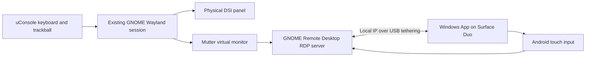

# How the monitor works

## USB is the transport, not a video cable

The Duo is not receiving HDMI or DisplayPort and the uConsole is not acting as a USB display gadget. Android USB tethering enumerates a USB networking function; Linux's rndis_host driver handled the tested device. Android supplies DHCP. RDP packets traverse that local link. Internet service is unnecessary for the intended data path, although installing the Android app initially requires a download.

## One desktop session, an additional monitor

GNOME Desktop Sharing operates inside the existing user's graphical session. With screen-share-mode=mirror-primary, RDP mirrors the built-in1280x720 panel. Fitting that wide image into a tall Android viewport creates unused space.

With screen-share-mode=extend, GNOME creates a virtual monitor using the dimensions advertised by the RDP client. On this setup Mutter reported1800x2700 at 2x scale, giving a900x1350 logical desktop. The built-in panel remained1280x720 at approximately59.90Hz. The physical keyboard and trackball feed the same compositor, so they can control windows on either output. Android touch is a second input path to that session.

RDP's display-control capability can request resolution changes, but rotation/resizing behavior depends on the Android client. A reported60Hz virtual mode is a compositor timing field, not measured USB bandwidth or delivered frame rate. No physical panel overclock is involved.

## Primary monitor, top bar and dock

GNOME normally places its top bar on the primary monitor. Merely adding a virtual monitor can leave Android showing only wallpaper. The included watcher uses org.gnome.Mutter.DisplayConfig.GetCurrentState and ApplyMonitorsConfig to select the single virtual remote monitor as primary. It retains scales and positions, applies a temporary configuration, and listens for MonitorsChanged instead of polling. Ubuntu Dock's multi-monitor setting supplies a dock on both outputs.

## The Duo hinge

The client advertised one tall monitor covering both panels. Ubuntu does not know the hinge's physical dimensions. We intentionally retain that single large desktop: apps can maximize or use fullscreen across both panels. Ubuntu Tiling Assistant adds optional top/bottom half snapping. Its split follows the usable work area, so the bar/dock can shift the split relative to the hinge. This repository does not claim exact hinge compensation or two independent monitor enumeration.

## Cursor rendering

The local trackball moved the real GNOME pointer and could activate controls even when the pointer image was not visible in the remote view. RDP cursor handling and captured pixels are separate; changing Android touch mode alone did not solve the observed physical-pointer problem.

The successful workaround enables GNOME's magnifier with mag-factor1.0. The magnifier's compositing path renders its cursor into the view while leaving content unzoomed. The owner confirmed visibility. This is observed behavior on the recorded versions, not proof of a universal fix or a fully diagnosed root cause. Additional compositor work can affect power and frame rate; these were not benchmarked.

## Security boundary

The RDP server requires credentials and TLS. A dedicated nftables table rejects port 3390 on non-loopback interfaces unless the interface is in the enrolled USB set. NetworkManager's root-owned dispatcher matches USB vendor/product/serial/driver using udev properties. The root-only enrollment JSON is local and not committed.

USB identifiers can be spoofed; matching them is an allowlist, not an authentication protocol. Keep RDP authentication and certificate checks. The rules do not expose a public listener through a router, do not alter Wi-Fi authentication, and do not remove other firewall tables. Desktop sharing grants control as the logged-in user, so protect the Android device and its saved credentials.

## References

- GNOME screen-share-mode semantics: https://lists.gnome.org/archives/commits-list/2022-February/msg14593.html
- Ubuntu desktop sharing: https://ubuntu.com/desktop/docs/en/latest/how-to/share-your-desktop-remotely/
- GNOME configuration: https://github.com/GNOME/gnome-remote-desktop/blob/main/docs/configuration.md
- GNOME magnification: https://wiki.gnome.org/Projects/GnomeShell/Magnification
- Windows App input: https://learn.microsoft.com/en-us/windows-app/input-keyboard-mouse-touch-pen
- Android USB tethering: https://support.google.com/android/answer/9059108
